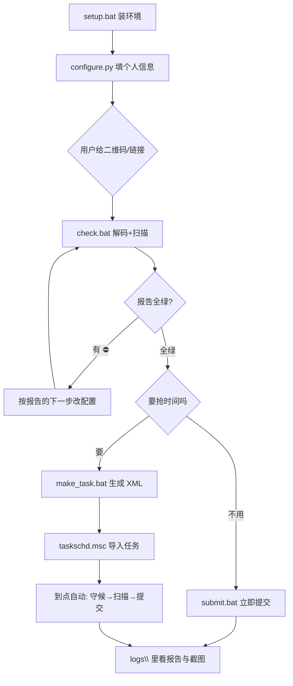

# 问卷星自动填报（通用版）

给 Windows 10 / 11 用的一句话报名工具：**发一张问卷星二维码，自动填表、自动抢名额**。

- 不用改代码、不用手写脚本，个人信息填一次永久复用
- 复用系统 Edge，不下 300MB 的 Chromium，不装全局包
- 不猜答案、不提交残缺答卷：遇到脚本不会的题型就停下来告诉你怎么补
- 定时开放的问卷可以守候到点抢，也可以挂到 Windows 任务计划里全自动

---

## 一键部署（推荐）

```bat
git clone <本仓库地址>
cd wjx-autofill
setup.bat
```

`setup.bat` 会：建 `.venv` 隔离环境 → 装 `playwright` / `opencv-python-headless` / `numpy`
→ 自检 Edge 与配置。**首次约 2~6 分钟**，之后秒级完成。

机器上还没有 Python？先装 [Python 3.8+](https://www.python.org/downloads/windows/)，
安装时**务必勾选 `Add python.exe to PATH`**，再跑 `setup.bat`。

## 然后填一次个人信息

```bat
.venv\Scripts\python.exe configure.py --name 张三 --sid 20240001 --gender 男 ^
  --college 信息工程学院 --major 计算机科学与技术 --clazz 计算机2301 --grade 大一
```

不想敲参数就直接 `python configure.py`，按提示一项项输。

| 参数 | 说明 |
|---|---|
| `--name` `--sid` | 姓名、学号（必填） |
| `--gender` | 男 / 女（单选题会真的去点选项） |
| `--college` `--major` `--clazz` `--grade` | 学院、专业、班级、年级 |
| `--phone` | 手机号，问卷问到再填 |
| `--show` | 查看当前配置（默认打码） |

## 最后：给二维码

1. 把问卷星二维码截图放进 `qrcode\` 目录
2. 双击 **`check.bat`** → 解码二维码、打开问卷、扫描题目、生成 `logs\report_latest.txt`
3. 报告全绿 → 双击 **`submit.bat`** 提交
4. 报告有 ⛔ → 照着「下一步」改，改完重跑 `check.bat`

只有 `submit.bat` / 定时任务会提交，`check.bat` 永远不提交。

---

## 手动流程（不用 bat 时）

```bat
rem 环境
python setup_env.py
python setup_env.py --check      rem 只自检

rem 配置
python configure.py --name 张三 --sid 20240001 --gender 男 --college X --major Y --clazz Z --grade 大一
python configure.py --show

rem 二维码 -> 链接
python decode_qr.py --dir qrcode

rem 检查（不提交）
python wjx_signup.py --dry-run

rem 提交
python wjx_signup.py --submit-now

rem 守候到问卷开放再提交
python wjx_signup.py --wait-open --submit-now --max-wait 2400

rem 生成定时任务 XML
python make_task.py "2026-10-22 12:00:00"
```

## 流程



## 常见问题

| 问题 | 处理 |
|---|---|
| 装依赖失败 | 检查网络；脚本会自动切清华镜像，仍失败就手工 `pip install -r requirements.txt` |
| 没有 Edge | 装 Edge，或改 `wjx_signup.py` 里 `channel="msedge"` 为 `"chrome"` |
| 报告说「题型是多选/下拉/日期」 | 这些不支持自动填，浏览器里手填后自己点提交 |
| 报告说「页面上一道题都没有」 | 问卷还没开放（服务端不给题目），用 `--wait-open` 守候或等开放 |
| 导入任务 XML 报 `unable to switch the encoding` | 导 `wjx_task.xml`（UTF-16），不要导 `wjx_task_utf8.xml` |
| 定时任务到点没跑 | 检查电脑是否**注销/重启**过（InteractiveToken 需要已登录）；笔记本是否**插着电源** |

## 安全与隐私

- 所有数据只存在本机 `wjx_config.json`，不外传
- 报告与日志里学号/手机号默认打码
- 不破解任何验证码，遇到网易易盾会响铃等用户点一下
- 不写注册表、不改系统设置、不装全局 Python 包

## 目录

| 文件 | 作用 |
|---|---|
| `setup.bat` / `setup_env.py` | 一键环境准备与自检 |
| `configure.py` | 个人信息配置 |
| `check.bat` | 检查（永不提交） |
| `submit.bat` | 立即提交 |
| `auto_submit.bat` | 定时任务入口（守候到点再提交） |
| `make_task.bat` / `make_task.py` | 生成 Windows 任务计划 XML |
| `wjx_kit.py` | 纯函数：闸门、报告、配置、时间解析 |
| `wjx_signup.py` | 主脚本（Playwright） |
| `decode_qr.py` | 二维码 → 链接 |
| `tests/` | 单测，改代码前先跑 |

## 开发

```bat
.venv\Scripts\python.exe tests\test_kit.py
.venv\Scripts\python.exe tests\radio_fixture_check.py
```

两套都必须全绿再提交改动。

## License

MIT
